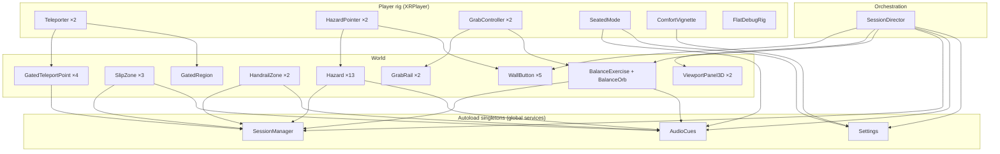
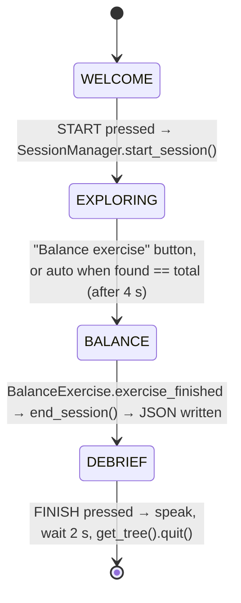

# VR Fall-Prevention Trainer: full system analysis

> **Status: every finding in this document was fixed on 23 September 2026.** See `CHANGELOG.md`
> for what changed, file by file. This document is kept as written, as the record of what was
> wrong and why — the code it describes is the code as it was before that pass.
>
> **Superseded in places by the realism pass of 25 September 2026.** The architecture
> described below is unchanged — every hazard, zone, rail, teleport disc, collision
> layer and score is exactly as documented, and that was verified by diffing a
> gameplay inventory before and after. What changed is only what you can see: the
> house is no longer built from flat coloured boxes. See "How the house is made to
> look real" in `README.md` for the generated textures, the material library, the
> joinery and the real windows.

*Analysis date: 22 September 2026. Covers every file in the project folder (29 GDScript files, 9 scenes, the OpenXR action map, `project.godot`, the Python report tool and both Markdown docs), about 6,200 lines in total.*

This document explains how the whole system works: architecture, runtime flow, every subsystem, the world layout, the data model and the input model. It then lists the problems found, ordered by severity, with file/line references and concrete fixes. `README.md` is the user-facing guide. This file is the engineering view, and it checks the README's claims against the code.

---

## 1. Summary

The project is a Godot 4 / OpenXR training app for older adults. It has three training tasks:

1. **Hazard recognition.** The participant walks through a four-room house, points at fall hazards and pulls the trigger to flag them.
2. **Handrail compliance.** The participant has to hold a rail on the stairs and a grab bar at the bath. Compliance is measured, and on the stairs it is also enforced through locomotion.
3. **Balance reach test.** Three reach-and-touch trials. Head sway is measured relative to a baseline captured at "Go!".

Every session is scored (50 % hazards / 30 % handrail / 20 % balance, re-normalised over the parts that ran). The result is appended to `user://session_log.json`, and a debrief panel compares it with the previous session.

**Overall assessment.** The code is clean and well commented, and the accessibility reasoning is careful. It has no external dependencies and a working desktop fallback, which is unusual for a student VR project. The architecture itself is sound. However, the scene data has several geometry and orientation errors that break the core flow in a headset, and the desktop rig hides them. The most serious: the stair handrail cannot be reached, the stairwell has no exit once you enter it, and the start panel and buttons face the wall. Seated mode also loses its height offset on the first teleport. All of these can be fixed in a few lines each (see §11). Nothing needs to be re-architected.

---

## 2. Technology and configuration

| Item | Value | Source |
|---|---|---|
| Engine | Godot **4.7** (`config/features` = "4.7", and `main.tscn` uses 4.6+ `unique_id` attributes) | `project.godot`, `scenes/main.tscn` |
| Renderer | Forward+ (desktop class). MSAA 3D 2×, soft shadow quality 1 | `project.godot` |
| XR | OpenXR, **disabled by default** (no `xr/openxr/enabled` key). Form factor HMD, stereo view, Stage reference space, XR shaders on | `project.godot` |
| Physics | 90 ticks/s (matches common 90 Hz headsets) | `project.godot` |
| Autoloads | `Settings`, `SessionManager`, `AudioCues`, in that order | `project.godot` |
| Audio | OS text-to-speech enabled (`audio/general/text_to_speech=true`). Cue tones are synthesised at runtime, so there are no audio assets | `audio_cues.gd` |
| Addons | None required. `godot-xr-tools` is optional through `XRToolsBridge` | `xr_tools_bridge.gd` |
| Offline tooling | Python 3 with only the standard library | `tools/report_sessions.py` |
| Version control | **None.** No `.git` and no `.gitignore` in the folder | — |

---

## 3. Repository map

```
VR-project/
├── project.godot                 engine config, autoloads, physics layer names, desktop input map
├── openxr_action_map.tres        the 4-action VR input map (Fix 5.4)
├── README.md                     user guide + design rationale
├── review_1_talk_script.md       5-minute talk track for Review 1 (object inventory)
├── tools/report_sessions.py      cross-session report / CSV export (166 lines)
├── scenes/
│   ├── main.tscn                 the whole session: house, player, panels, buttons, director
│   ├── smoke_test.tscn           dependency-free diagnostic scene
│   ├── player/xr_player.tscn     XROrigin3D rig: camera+vignette, probe, 2 hands × 3 tools, seated mode, flat rig
│   ├── rooms/{hallway,bathroom,bedroom,staircase}.tscn
│   └── ui/{instruction,debrief}_panel.tscn   bare Control roots with a script
├── scripts/
│   ├── session_director.gd       stage machine: WELCOME → EXPLORING → BALANCE → DEBRIEF   (231)
│   ├── smoke_test.gd             (64)
│   ├── autoload/
│   │   ├── settings.gd           persistent accessibility settings (user://settings.cfg)   (101)
│   │   ├── session_manager.gd    registration, recording, scoring, tips, JSON persistence  (481)
│   │   └── audio_cues.gd         head-locked tones + TTS                                   (195)
│   ├── player/
│   │   ├── xr_player.gd          XR start-up, hand roles, probe, teleport_to()             (192)
│   │   ├── teleporter.gd         arc teleport, free vs gated-points mode                   (308)
│   │   ├── hazard_pointer.gd     flag ray + wall-button presses                            (211)
│   │   ├── grab_controller.gd    proximity grip                                            (197)
│   │   ├── seated_mode.gd        measured seated height offset (Fix 5.2)                   (197)
│   │   ├── comfort_vignette.gd   tunnelling + slip flash shader quad                       (121)
│   │   └── flat_debug_rig.gd     WASD/mouse fallback                                       (189)
│   ├── world/
│   │   ├── hazard.gd             flaggable Area3D (hazard or decoy)                        (179)
│   │   ├── slip_zone.gd          non-vestibular "near miss" trigger                        (87)
│   │   ├── grab_rail.gd          holdable rail / grab bar                                  (188)
│   │   ├── handrail_zone.gd      grip-fraction compliance measurement                      (130)
│   │   ├── gated_region.gd       where free teleport is disabled (Fix 5.1)                 (94)
│   │   ├── gated_teleport_point.gd  rail-gated, chained destinations (Fix 5.1)             (189)
│   │   ├── room_builder.gd       procedural floor/ceiling/walls with openings              (192)
│   │   ├── staircase.gd          procedural treads + landing, uneven tread                 (119)
│   │   └── prop.gd               primitive furniture (box/cylinder/sphere)                 (121)
│   ├── balance/
│   │   ├── balance_exercise.gd   3-trial reach test, baseline sway (Fix 5.5)               (262)
│   │   └── balance_orb.gd        touch/grip target                                         (102)
│   ├── ui/
│   │   ├── viewport_panel_3d.gd  SubViewport→quad world panel (Fix 5.3)                    (125)
│   │   ├── instruction_panel.gd  title/body/status panel                                   (110)
│   │   ├── debrief_panel.gd      results screen + spoken summary                           (265)
│   │   └── wall_button.gd        physical menu button (Fix 5.4)                            (152)
│   └── util/
│       ├── auto_shape.gd         builds collision shapes from `extents`                    (94)
│       └── xr_tools_bridge.gd    optional godot-xr-tools adapter                           (136)
└── .godot/                       editor cache (shader caches, uid cache): should not be versioned
```

---

## 4. Architecture

### 4.1 Layers

The system has four layers. Each one only talks to the layer below it or to the autoloads.



Four design patterns hold the system together:

- **Self-registration.** `Hazard` and `HandrailZone` register themselves with `SessionManager` in `_ready()`, so scoring denominators come from the scene rather than being hard-coded. Adding a hazard node is the only step needed to add a hazard.
- **Duck typing at the edges.** The pointer activates anything with a `press()` method. The grabber grabs anything with `grab()`. The xr-tools bridge detects addon nodes by property or signal presence. This keeps the addon optional and lets new interactables slot in.
- **Physics layers as the interaction contract.** Each tool's ray or area only masks the layers it should see (§4.3), so the interaction code needs no special cases.
- **One mover.** `XRPlayer.teleport_to()` is the only code that relocates the player in VR. The desktop rig is the exception: it moves the origin directly.

### 4.2 Scene tree (runtime, `main.tscn`)

```
Main (Node3D)
├── WorldEnvironment, SunThroughWindows (DirectionalLight3D)
├── House
│   ├── Hallway    @ (0, 0, 0)
│   ├── Bathroom   @ (-2.5, 0, -2.8)
│   ├── Bedroom    @ (2.5, 0, -3.1)
│   └── Staircase  @ (0, 0, 3.9)
├── XRPlayer (xr_player.tscn) @ (-2, 0.199, 0)
│   ├── XRCamera3D └── ComfortVignette
│   ├── SeatedMode, PlayerProbe (Area3D, layer 2, sphere r=0.24 at y=0.9)
│   ├── LeftHand  (XRController3D, pose "aim") ├── Teleporter ├── GrabController ├── HazardPointer
│   ├── RightHand (XRController3D, pose "aim") ├── Teleporter ├── GrabController ├── HazardPointer
│   ├── FlatDebugRig
│   └── XRToolsBridge
├── InstructionPanel (ViewportPanel3D → instruction_panel.tscn)
├── ButtonStart / ButtonSeated / ButtonRepeat   (west wall)
├── ButtonBalance / ButtonFinish                (east wall)
├── BalanceExercise └── BalanceOrb
├── DebriefPanel (ViewportPanel3D → debrief_panel.tscn, hidden)
└── SessionDirector
```

Both hands carry all three tools. `XRPlayer._assign_hand_roles()` enables the teleporter on the *move* hand and the pointer on the *point* hand. Grab stays live on both. Setting `left_handed` swaps the roles.

### 4.3 Physics layers

| Layer | Name | On it | Detected / hit by |
|---|---|---|---|
| 1 | world | RoomBuilder slabs, Staircase blocks, solid Props | teleport arc (bodies), pointer ray (to stop at walls) |
| 2 | player | PlayerProbe | HandrailZone, SlipZone, GatedRegion |
| 3 | hazard | Hazard areas | pointer ray |
| 4 | grabbable | GrabRail, BalanceOrb | hand GrabArea |
| 5 | teleport_target | GatedTeleportPoint | teleport arc (areas) |
| 6 | ui | WallButton | pointer ray |
| 7 | hand | GrabArea on each hand | GrabRail (glow), BalanceOrb (touch), WallButton (touch press) |

### 4.4 Signals worth knowing

`SessionManager` emits `session_started`, `session_ended(summary)`, `hazard_flagged`, `hazard_progress_changed(found,total)`, `handrail_result`, `balance_trial_recorded`. Only `hazard_progress_changed` has a listener (the director); the rest are available for extensions. `Settings.settings_changed` drives AudioCues volume, SeatedMode, ComfortVignette and the InstructionPanel status rows. `GrabRail.grabbed/released` drives GatedTeleportPoint activation. `BalanceExercise.exercise_finished` triggers the debrief.

---

## 5. Runtime lifecycle

### 5.1 Boot order

1. The autoloads start in order. `Settings._ready` prints the boot banner and loads `user://settings.cfg`, then `SessionManager` starts, then `AudioCues`, which builds 7 sine tones and picks the first English TTS voice.
2. `main.tscn` loads, and children are ready before their parents:
   - The room scenes build their geometry (RoomBuilder, Staircase, Prop). Every `Hazard` with `is_hazard=true` registers (10 in total), and every `HandrailZone` registers (2).
   - The player rig starts. `SeatedMode._ready` runs *before* `XRPlayer._ready`, so its camera reference is null at this point and is re-fetched later. Then `XRPlayer` assigns hand roles and tries OpenXR. If that fails, it enables `FlatDebugRig`.
   - `SessionDirector._ready` prints the hazard count, resolves node paths, wires the buttons, shows the Welcome step and, after 2 s, speaks it.

The expected console output is in the README. The smoke-test scene isolates engine problems from project problems.

### 5.2 Session state machine (`session_director.gd`)



Button enablement: START only in WELCOME. Seated mode everywhere except BALANCE, because re-calibrating would invalidate the baseline. "Say that again" everywhere except DEBRIEF. Balance only in EXPLORING. FINISH only in DEBRIEF. Nothing advances on a timer except the optional auto-start of the balance task.

Before START, `Hazard.flag_hazard()` refuses and plays "reject", so the hazard stays available. Zones still fire but their events are discarded, because `start_session()` clears `_events`.

---

## 6. Subsystems in detail

### 6.1 Hazard recognition (Core A): `hazard.gd`, `hazard_pointer.gd`

- **Hazard** is an `Area3D` on layer 3 with an auto-generated box from `extents`. On hover it applies a yellow emissive `material_overlay` to its meshes (or all descendant meshes). On a correct flag it turns green, spawns a billboard `Label3D` with the name, plays "confirm" and speaks the name plus its explanation. For decoys (`is_hazard=false`) it records a false positive and plays "reject". The hazard ID is generated from room and node name if left blank.
- **HazardPointer** is a `RayCast3D` from the aim pose, 6 m long, masking layers 1, 3 and 6. A world hit only shortens the beam, while a hit on a Hazard or on anything with `press()` becomes the target. The beam is idle blue and turns yellow on a target. The trigger (`trigger_click`) activates the target. `dwell_to_confirm` (0 by default) enables hands-free flagging for users with a tremor.
- Scoring: `found / total × 100`. `time_to_flag_s` is stored per hazard.

### 6.2 Handrail compliance (Core B): `grab_rail.gd`, `grab_controller.gd`, `handrail_zone.gd`

- **GrabRail** is an Area3D on layer 4. It auto-builds a tube along local X with two brackets and an X-aligned capsule of radius 2.5 × the tube radius. It glows blue when a hand is in range and green when held. `closest_hold_point()` clamps to the span. It auto-releases when the holding hand's area leaves.
- **GrabController** is a sphere of radius 0.14 m on layer 7 that masks layer 4. Pressing grip grabs the nearest overlapping grabbable (rails are measured to their closest point). A box "palm" narrows when gripping and turns green when holding.
- **HandrailZone** watches the probe. While inside it accumulates `grip_time` whenever `rail.is_held`. After `remind_after_seconds` without grip it plays a reminder tone and speaks "Try using the rail here", then says "Good" when the participant grips. On exit, if the transit lasted at least `min_transit_seconds`, it records `complied = grip_time/transit ≥ min_grip_fraction` (0.6 for the stairs, 0.5 for the bath).
- Scoring: `complied zones / attempted zones × 100`. Note that each zone stores only its *last* transit (see F-M3).

### 6.3 Gated locomotion (Fix 5.1): `teleporter.gd`, `gated_region.gd`, `gated_teleport_point.gd`

- **Teleporter** uses hold-to-aim and release-to-commit. The ballistic arc runs 24 steps of 0.06 s at 6 m/s and ray-tests each segment against layer 1 bodies and layer 5 areas. Hit resolution works like this:
  1. A direct hit on a GatedTeleportPoint is valid only if the point `is_active()`.
  2. Otherwise, if the **player** is inside an enforcing GatedRegion, *or* the **hit point** is inside one, the arc snaps to the nearest active point within 1.2 m, or the aim is invalid.
  3. Otherwise it is a free floor hit, valid if the surface is within 30° of level and within 5 m.

  An invalid commit plays "reject". Inside a gated region it also speaks "Hold the rail, then point at the next green step."
- **GatedRegion** keeps static lists of all regions and occupied regions. `is_player_gated()` checks the origin side and `is_point_gated(p)` checks the destination side.
- **GatedTeleportPoint** is a disc on layer 5. It is active only when its `requires_previous` point has been used and its `required_rail` is held. It shows "Step here", "Use the step below first" or "Hold the rail to unlock". `consume()` marks it used and returns the arrival transform, including `arrival_yaw_degrees`.

### 6.4 Seated mode (Fix 5.2): `seated_mode.gd`

Toggling seated mode ON triggers a 3 s settle phase, then 1 s of sampling `camera.transform.origin.y` (local to the origin, so it is the physical head height). The **median** sample is used, and `offset = clamp(standing_eye_height − seated_head, 0, 1.2)` is applied as `XRPlayer.position.y = _base_y + offset`. The same offset is pushed to `XRToolsPlayerBody` if that node is present. Toggling OFF restores `_base_y`. (See F-H1 and F-H2: this interacts badly with teleport and with persisted settings.)

### 6.5 Balance reach test (Core C, Fix 5.5): `balance_exercise.gd`, `balance_orb.gd`

For each yaw offset in `[0°, +45°, −45°]`:

1. A 3 s countdown with a beep and a spoken number every second. The orb is disarmed during the countdown.
2. On "Go!", `_baseline = camera.global_position` is captured. The orb is placed at `baseline + dir(yaw) × 0.55 m − 0.15 m vertically`.
3. Every physics frame, horizontal sway = ‖(Δx, Δz)‖ from the baseline. The code tracks max, sum and count.
4. The trial ends on a touch (the hand area entering the orb, or grip on the orb) or after a 25 s timeout. Stability = `100 × (1 − clamp((0.65·mean + 0.35·max)/0.20 m, 0, 1))`.

The session balance score is the mean stability over **all** recorded trials (see F-H5).

### 6.6 Comfort (Core D): `comfort_vignette.gd`, `teleporter.gd`

- Locomotion is teleport-only. `Settings.smooth_locomotion` exists but nothing implements it. There is no snap turn.
- **ComfortVignette** is a shader quad parented to the camera, 6 cm in front. It closes toward `closed_radius` when yaw rate exceeds 45°/s, and `flash()` tints the periphery red for SlipZone. `set_forced()` exists but is never called. (See F-H6: the quad is so large that the effect falls outside the headset's field of view.)
- **SlipZone** triggers on probe entry, with a 6 s cooldown. It logs `near_miss` (plus whether the linked hazard was already flagged), plays the reminder tone, speaks a warning if the hazard was not yet recognised, and flashes the vignette. It never moves the camera.

### 6.7 Sensory accessibility (Fix 5.3): `audio_cues.gd`, `viewport_panel_3d.gd`, panels

- **AudioCues** has two non-positional `AudioStreamPlayer`s: one for cues and one for voice-over streams. Tones are 16-bit mono at 22,050 Hz with an 8 ms fade in and out, and "two-tone" cues jump a fifth halfway through. Speech uses `DisplayServer.tts_speak(text, voice, 100, 1.0, 0.85)` and calls `tts_stop()` first on every call.
- **ViewportPanel3D** renders a 1600×1200 SubViewport (3D disabled, always updating) onto an unshaded, double-sided quad (1.2×0.9 m by default). It can follow the player, or be placed once in front of them with `place_in_front_of_player()` (1.75 m ahead, 8° below eye level).
- **InstructionPanel** shows a title, body text and On/Off status rows for seated mode, vignette and speech. The words carry the state and colour only reinforces it.
- **DebriefPanel** shows the overall score, deltas with ↑/↓ words, per-component bars and tips, and speaks a short summary. The colour contract is #1E1E22 background with warm white and amber text.

### 6.8 Input simplification (Fix 5.4): `openxr_action_map.tres`, `wall_button.gd`

- The action set "godot" declares four actions: `default` (grip pose), `aim` (aim pose), `trigger_click` and `grip_click`. Bindings exist for three interaction profiles: KHR simple (no grip), Oculus Touch (trigger and squeeze *values* bound to boolean actions, thresholded by the runtime) and HTC Vive. Undeclared buttons are never delivered.
- **WallButton** is an Area3D on layer 6 that masks layer 7. It can be pressed by pointer, by hand touch, or directly. It has a 0.8 s debounce, a grey disabled state, and logs `button_pressed`.

### 6.9 World construction: `room_builder.gd`, `staircase.gd`, `prop.gd`, `auto_shape.gd`

All geometry is procedural and `@tool`, so it is visible in the editor.

- **RoomBuilder** builds floor and ceiling slabs and four walls, split around openings given as `Vector4(wall, offset, width, height)`, with a lintel above each opening. Each piece is a StaticBody3D on layer 1 with a box mesh.
- **Staircase** builds solid tread blocks from the floor up (rise 0.19, going 0.25, width 0.9). Tread *N* and everything above it gets +25 mm, so the step onto tread N is the tall one, and it has the same colour on purpose. It ends in a landing.
- **Prop** makes a box, cylinder or sphere mesh with an optional layer-1 collider and optional emission.
- **AutoShape** gives any trigger a collision shape from its `extents` unless the scene supplies one.

### 6.10 Desktop fallback and diagnostics

- **FlatDebugRig** is active when OpenXR fails. WASD moves the *origin* directly (no collision, no gating). The mouse rotates the XRCamera3D. The hands are parked at camera offsets. Left click triggers the pointers. Right click is both grip *and* teleport aim/commit. Q/E change eye height. The first click only captures the mouse.
- **smoke_test** is a scene with no project dependencies. It prints the engine version, platform, GPU and user path, and shows a spinning box.

### 6.11 Optional godot-xr-tools bridge: `xr_tools_bridge.gd`

It scans the scene for nodes with `picked_up`/`dropped` signals (Pickables), a `can_teleport` property (FunctionTeleport) or a `player_calibrate_height` property (PlayerBody). It forwards pickable grab/drop to a parent or sibling GrabRail, sets `can_teleport=false` on the addon teleporters while the player is gated, and hands the PlayerBody to SeatedMode.

---

## 7. World layout (computed world coordinates, 1 unit = 1 m)

| Space | Centre | X range | Z range | Notes |
|---|---|---|---|---|
| Hallway 8 × 2.6 | (0, 0, 0) | −4 … 4 | −1.3 … 1.3 | Doors at x = −2.5 and +2.5 on the north wall (z = −1.3), and at x = 0 on the south wall (z = +1.3) |
| Bathroom 3 × 3 | (−2.5, 0, −2.8) | −4 … −1 | −4.3 … −1.3 | Door on its south wall, lined up with the hallway door |
| Bedroom 4 × 3.6 | (2.5, 0, −3.1) | 0.5 … 4.5 | −4.9 … −1.3 | Sticks out 0.5 m past the hallway's east end |
| Stairwell 2.6 × 5.2 | (0, 0, 3.9) | −1.3 … 1.3 | 1.3 … 6.5 | No ceiling, 4 m walls, no upper floor |
| Stair flight | — | −0.45 … 0.45 | 3.5 … 5.5 | 8 treads, top at 1.545 m. The step onto tread 5 is the tall one |
| Landing | — | −0.45 … 0.45 | 5.5 … 6.3 | 1.545 m high, dead end |
| StairRailWest | (−1.1, 1.78, 4.5) | at x = −1.1 | 3.35 … 5.65 | **Horizontal at 1.78 m and 0.65 m beyond the tread edge**: see F-C1 |
| TP_Bottom / Step3 / Step6 / Landing | x = 0 | — | 2.3 / 4.125 / 4.875 / 5.9 | at y = 0.02 / 0.59 / 1.185 / 1.565 |
| StairGate (GatedRegion) | (0, 1.8, 3.9) | −1.25 … 1.25 | 1.35 … 6.45 | Contains TP_Bottom |
| StairTransitZone | (0, 1.4, 4.4) | −1.2 … 1.2 | 2.7 … 6.1 | TP_Bottom is outside it, the landing is inside it |
| Player spawn | (−2, 0.199, 0) | — | — | Faces **+X (east)**: see F-C3 |
| Instruction panel | (−3.85, 1.45, 0) | — | — | Front face points −X, toward the wall |
| Start / Seated / Repeat | x = −3.88, y = 0.95 | — | z = −0.62 / 0 / 0.62 | Faces point −X |
| Balance / Finish | x = 3.9, y = 0.95 | — | z = −0.4 / 0.4 | Faces point +X |

Hazard inventory (10 hazards, 3 decoys), with the matching `hazard_id` → advice key in `session_manager._advice_for()`. All 10 keys match.

| Room | Hazard IDs | Decoy IDs | Extra triggers |
|---|---|---|---|
| Hallway | `hall_rug_edge`, `hall_extension_cord` | `hall_console_table` | SlipZone on the rug |
| Bathroom | `bathroom_wet_floor`, `bathroom_no_grab_bar` | `bathroom_towel_rail` | SlipZone on the wet floor; TubGrabBar + TubTransferZone |
| Staircase | `stairs_missing_rail`, `stairs_dim_light`, `stairs_uneven_step` | — | StairRailWest, StairTransitZone, StairGate, 4 teleport points |
| Bedroom | `bed_armless_chair`, `bed_dim_light`, `bed_floor_clutter` | `bed_wardrobe` | SlipZone on the clutter |

---

## 8. Data model and analytics

### 8.1 Files written

| File | Writer | Contents |
|---|---|---|
| `user://settings.cfg` | `Settings.save_settings()` on every `set_option` | comfort, sensory and session sections (8 keys) |
| `user://session_log.json` | `SessionManager._append_to_log()` at the end of the session | `{schema_version:1, participant_id, sessions:[…]}`, oldest first, tab-indented |

Each session record holds: `session_id` (UTC timestamp plus 4 random digits), `participant_id`, `started_utc`, `duration_seconds`, a `settings` snapshot, `hazards{total, found, accuracy_pct, false_positives, detail[]}`, `handrail{opportunities, complied, compliance_pct, detail[]}`, `balance{trials, mean_completion_s, mean_stability, max_sway_cm, detail[]}`, `score{hazard, handrail, balance, overall}`, `delta` against the previous session, `tips[]`, and `events[]`, the chronological audit trail.

### 8.2 Event types written to `events[]`

`session_started`, `session_ended`, `hazard_flagged`, `false_positive`, `teleport`, `teleport_point_used`, `gated_region_entered/exited`, `handrail_zone_entered`, `handrail_zone_grazed`, `handrail_transit`, `handrail_reminder`, `grab`, `release`, `near_miss`, `button_pressed`, `seated_calibration_started/finished`, `seated_mode_off`, `balance_exercise_started/finished`, `balance_trial_started`, `balance_trial`.

### 8.3 Scoring

```
hazard   = 100 · found / total
handrail = 100 · complied_zones / attempted_zones        (only if ≥1 zone attempted)
balance  = mean(stability_score over ALL recorded trials) (only if ≥1 trial)
overall  = Σ(score_i · w_i) / Σ w_i  over components that ran, w = 0.5 / 0.3 / 0.2
```

Tips list every missed hazard with room-specific advice, a rail tip if compliance is below 100 %, a balance tip if stability is below 80, a reassurance line if there were more than 3 false positives, and a fallback "Excellent session".

### 8.4 `tools/report_sessions.py`

This script loads the log, flattens each session into 18 columns and prints a per-session table with the change from the previous session. It also prints a first-to-latest trend (sway is inverted, because lower is better) and the hazards missed in *every* session. `--csv` writes a tidy file. It uses only the standard library and reads the current schema correctly.

---

## 9. Input reference

| Context | Move hand (left by default) | Point hand (right) | Either hand |
|---|---|---|---|
| VR | trigger held = arc, release = go | trigger = flag / press button | grip = hold rail or orb; touching a button presses it |
| Desktop | right-click hold = arc + grip, release = go | left click = flag / press | Q/E head height, WASD move, Esc frees the mouse |

---

## 10. Strengths worth keeping

- The accessibility rationale lives next to the code that implements it: head-locked audio, the 1.75 m panel, no black or pure white, no colour-only signals, no camera lurch, forgiving pass marks.
- Measurement is honest. Sway is taken relative to a baseline and only horizontally, the median is used for calibration, components that didn't run are re-normalised out, false positives are reported but not punished, and the audit trail is complete.
- The project runs with zero dependencies and has a smoke test, a desktop fallback and a standard-library analysis script. A marker can clone it and press Play.
- The architecture is extensible: self-registering hazards and zones, procedural rooms, and duck-typed interactables.

---

## 11. Findings

Severity: **Critical** means the core task cannot be completed in a headset. **High** means wrong behaviour or wrong data in normal use. **Medium** means a real defect with limited impact. **Low** means polish, documentation or maintainability.

A note on transforms: Godot writes `Transform3D(a,b,c, d,e,f, g,h,i, x,y,z)` **row by row**. The first three numbers are `basis.rows[0]`, not the X axis. This was confirmed against `core/variant/variant_parser.cpp`. Several hand-authored transforms in the scenes were written as if the numbers were columns, which is the cause of F-C1 and F-C3.

### Critical

**F-C1. The stair handrail cannot be reached, and it is not inclined.** `scenes/rooms/staircase.tscn`, node `StairRailWest`.
The basis `(0, 0.6051, 0.7962, 0, 0.7962, −0.6051, −1, 0, 0)` read as rows gives a local X axis of (0, 0, −1). The rail is therefore **horizontal**, at 1.78 m above the ground floor, running along Z. It is not sloped at 37° as the comment says. It also sits at x = −1.1, while the treads only span x = ±0.45 and every teleport point is at x = 0. From TP_Bottom the nearest part of the rail is about 1.5 m away horizontally and 1.78 m up. From TP_Step3 it is 1.1 m to the side. So in a headset the rail cannot be gripped, TP_Step3 never activates, the stairs cannot be climbed, and stair compliance always records a fail. The desktop rig hides this because WASD can walk you next to the wall.
*Fix:* move the rail to the tread edge and give it the intended slope:
`transform = Transform3D(0, 0, -1, 0.6051, 0.7962, 0, 0.7962, -0.6051, 0, -0.55, 1.78, 0.6)`
That puts the local X axis at (0, 0.605, 0.796), up the slope, with the rail 10 cm outside the tread. Check the height against the nosing line in the editor. Move the broken-rail brackets and `HazardMissingRail` to x ≈ +0.55 to match.

**F-C2. There is no way out of the stairwell once you enter it.** `teleporter.gd:171, 218` and `staircase.tscn`.
TP_Bottom (z = 2.3) lies *inside* StairGate (z 1.35–6.45). Once the participant arrives there, `is_player_gated()` is true, so every aim resolves only to active teleport points within 1.2 m of the hit. There is no point outside the stairwell, so the hallway can never be a destination again. The only ways out are to physically walk about 0.7 m backwards in room-scale, which a seated user cannot do, or to climb, which F-C1 prevents.
*Fix (also fixes F-H3):* shrink StairGate so it starts at the first tread (local z ≥ −0.5), which leaves TP_Bottom outside it. Then give TP_Bottom a `required_rail_path`, and make the rail requirement apply only while the player is gated:
```gdscript
# gated_teleport_point.gd
@export var rail_required_only_when_gated: bool = false
func is_active() -> bool:
    if _previous != null and not _previous.used_already:
        return false
    if _rail != null and not _rail.is_held:
        if not rail_required_only_when_gated or GatedRegion.is_player_gated():
            return false
    return true
```
Coming in from the hallway, TP_Bottom is then free. Coming down from the flight, it needs the rail. Standing on TP_Bottom, you are ungated and can teleport back to the hallway normally.

**F-C3. The spawn, the instruction panel and all five wall buttons face the wrong way.** `scenes/main.tscn`.
Read as rows, `Transform3D(0,0,-1, 0,1,0, 1,0,0, …)` is a −90° rotation about Y, so the XRPlayer faces **+X (east)**, away from the panel. The same basis on InstructionPanel, DebriefPanel and the west buttons turns their front (+Z) toward −X, into the wall 15 cm behind them. The east buttons use the opposite basis and face the east wall. The results:
- The participant starts with the panel behind them. The README says they start facing it.
- The panel quad is `CULL_DISABLED`, so from the room it is seen from behind, with the text **mirrored**.
- WallButton labels sit at local +Z 0.032, which is now between the button face and the wall, so they are **hidden** behind the face box.

The desktop view has the same problem, because FlatDebugRig starts at yaw 0 relative to the origin. Please take one look in the editor to confirm before changing anything; the maths is unambiguous, but it takes seconds to check.
*Fix:* swap the two bases. Use `Transform3D(0,0,1, 0,1,0, -1,0,0, …)` for XRPlayer, InstructionPanel, DebriefPanel and the three west buttons. Use `Transform3D(0,0,-1, 0,1,0, 1,0,0, …)` for ButtonBalance and ButtonFinish. Also set the player's y to 0 (see F-L5).

### High

**F-H1. Every teleport erases the seated-mode offset, and turning seated mode off drops the player through the stairs.** `xr_player.gd:179` and `seated_mode.gd:162,171`.
`teleport_to()` sets `global_position = target − head_offset` with `head_offset.y = 0`, so the origin lands at floor height and the seated lift is lost on the first move. `SeatedMode` applies and removes the offset against `_base_y`, which is the spawn height, so switching it off while on the landing (y = 1.565) puts the origin back at about 0.2 m.
*Fix:* treat the offset as relative to the current floor:
```gdscript
# seated_mode.gd
func _apply_offset(offset: float) -> void:
    _player.position.y += offset - current_offset
    current_offset = offset
    _push_to_xr_tools(offset)
func reset_to_standing() -> void:
    _apply_offset(0.0) ; _calibrating = false ; set_process(false)
    SessionManager.log_event("seated_mode_off", {})
# xr_player.gd, end of teleport_to():
var seated := get_node_or_null("SeatedMode") as SeatedMode
global_position = target_position - head_offset + Vector3.UP * (seated.current_offset if seated else 0.0)
```

**F-H2. A saved "seated mode ON" setting applies no offset on the next launch.** `seated_mode.gd:70-72`.
`Settings` loads `seated_mode=true` and emits `settings_changed` before SeatedMode is connected. `_ready` then calls `_apply_offset(current_offset)` with `current_offset == 0`. The panel and button say ON, but the geometry is standing height, and pressing the button turns it OFF.
*Fix:* in `_ready`, if `Settings.seated_mode` is true, call `start_calibration()` once XR has started (for example on `XRPlayer.xr_started`), or persist the measured offset in Settings.

**F-H3. The descent loophole (Fix 5.1 only works going up).** TP_Bottom has no rail requirement and is always active. From the landing, the participant can aim at it, or at any floor within 1.2 m of it, and jump down the whole flight without holding the rail. Descending is the more dangerous direction in the real world. The HandrailZone will record a fail, but the "enforced, not merely logged" claim does not hold for descent. The fix is the same as for F-C2.

**F-H4. Stair arrival yaw is reversed.** `staircase.tscn`, TP_* nodes.
In Godot, yaw 0 looks along −Z, but this flight ascends along +Z. TP_Bottom, Step3 and Step6 (yaw 0) therefore turn the participant to face *down* the stairs, and TP_Landing (yaw 180) faces the back wall. That is the opposite of the "face them up the stairs to remove the startle" intent.
*Fix:* use 180 for Bottom, Step3 and Step6, and 0 for the Landing (facing back down, ready to descend).

**F-H5. The balance score rewards not reaching, and penalises the advice the app gives.** `session_manager.gd:254` and `session_director.gd:61`.
- `balance_mean_stability()` averages **all** trials, including timeouts. A participant who stands still for 25 s, or whose orb spawned inside a wall or furniture because it is placed wherever they face, scores about 100 on that trial.
- The instructions say "Move your feet if you need to", and the low-stability tip says "Move your feet instead of stretching". Stepping moves the head horizontally, which is scored as sway, so following the advice lowers the score.
- On desktop the orb (0.55 m ahead) is outside the parked hand's reach, so the only way to touch it is to walk into it, which is scored as sway.

*Fix:* score stability over completed trials only, and report completion rate separately. Either change the wording to "keep your feet still and reach only as far as is comfortable", or exclude or flag steps (for example, by detecting sustained translation). Ray-check the orb position against layer 1 and rotate or shorten the reach if it is blocked.

**F-H6. The comfort vignette and the slip flash are drawn outside the field of view, so they have no visible effect.** `comfort_vignette.gd:61-63`.
The quad is 2.4 × 2.0 m at 6 cm from the eye, so shader distance d = 1 corresponds to about 87° off-axis. The "closed" radius of 0.42 (with feather 0.25, so it starts at d ≈ 0.17) begins at about 73°. The flash edge starts at d = 0.55, about 84°. Typical headsets show about ±50° and the desktop camera about ±37°, so the tunnelling and the red "near miss" flash are never seen. Only the audio part of the slip feedback reaches the participant.
*Fix:* size the quad to the view. For example, `quad.size = Vector2(0.14, 0.12)` at 0.06 m puts d = 1 at roughly 50°. Then re-tune `closed_radius` (≈ 0.55) and the flash edge (≈ 0.6–1.0). Also call `set_forced(true/false)` from `Teleporter.begin_aim/commit`, which the README describes but the code never does.

**F-H7. A corrupt log is silently overwritten, destroying the participant's history.** `session_manager.gd:419-449`.
If `session_log.json` fails to parse, `load_log()` returns an empty document, and `_append_to_log()` then writes it over the corrupt file. The write is also not atomic, so a crash or power loss mid-write corrupts the file and causes exactly that situation. For a study, this is the most consequential data risk.
*Fix:* write to `session_log.json.tmp`, then `DirAccess.rename_absolute()` it over the original. On a parse failure, copy the unreadable file to `session_log.corrupt-<timestamp>.json` before starting fresh.

### Medium

**F-M1. `started_utc` records the end time.** `session_manager.gd:361` calls `Time.get_datetime_string_from_system(true)` inside `build_summary()`, which runs at session end. Capture the timestamp in `start_session()` instead. The report tool's "date" column inherits this error.

**F-M2. The bathroom compliance zone penalises ordinary walking and contradicts its own hazard.** TubTransferZone (1.9 × 1.2 m) covers most of the bathroom's walkable floor, so going in to look at the wet floor triggers "Try using the rail here" after 2.5 s. The bar is at the far side of the tub (about 0.8 m reach across the tub), and the scene's premise is that there is *no* grab bar where you step in (`bathroom_no_grab_bar`). The participant is scored for not using a bar the scenario says is in the wrong place.
*Fix:* shrink the zone to the step-in area beside the tub, and either move the bar there or drop compliance scoring in the bathroom.

**F-M3. Handrail metrics do not mean what the UI says.**
- Each zone keeps only its **last** transit (`record_handrail_result` overwrites it), so "opportunities" is the number of zones visited (at most 2), not the number of crossings. The debrief says "held on for X of Y crossings".
- The tip "You went up or down the stairs N time(s)…" is also shown for bathroom failures.
- Because the landing is inside StairTransitZone, time spent standing on the landing (for example, letting go of the rail to flag the dim light with the pointer hand) counts against the grip fraction.

*Fix:* append every transit to a per-zone list, word the tip per room, and end the stair zone before the landing, or pause the timer while the player is stationary on a point.

**F-M4. Physics state is changed inside area signals, which raises errors.** `balance_orb.gd:88-89` and `wall_button.gd:96`. Setting `monitoring` or `CollisionShape3D.disabled` while an `area_entered` signal is being emitted is blocked by Godot ("Function blocked during in/out signal… use set_deferred"). This happens whenever the orb is touched by hand, and whenever a hand-pressed button changes stage (which calls `set_enabled` on the same button). The logic survives because of the `_armed` and `enabled` guards, but the errors appear in the Debugger and the monitoring change is silently skipped. *Fix:* `set_deferred("monitoring", …)` and `_shape.set_deferred("disabled", …)`.

**F-M5. Free teleport can land on furniture.** Any layer-1 surface within 30° of level and 5 m away is valid, including the top of the 2 m wardrobe, the bed, the bathtub rim, the sink, the console table and the chair seat. *Fix:* accept only bodies in a `walkable` group (RoomBuilder floors and stair landings), or require the hit height to be within about 5 cm of the current floor.

**F-M6. The resource UIDs in `main.tscn` do not match the sub-scenes.** All seven `ext_resource` UIDs for the room, player and UI scenes (for example `uid://u1pgfghyqnlg`) differ from the UIDs declared in those files (for example `uid://cvrfp0player01`), which were hand-written. Godot falls back to the path with a warning on every load, and renaming or moving a scene would break the reference. *Fix:* open and re-save each sub-scene and `main.tscn` in the editor, or run *Project → Tools → Upgrade Project Files*.

**F-M7. Procedural geometry will duplicate itself when a room scene is saved in the editor.** `room_builder.gd:192`, `staircase.gd:119`, `prop.gd:84`.
In the editor, the generated bodies get `owner = owner`, so saving writes them into the `.tscn`. Their children are not owned, so they are saved without shapes or meshes, and their group membership is not persistent. On the next load, `_clear()` doesn't recognise them and `build()` adds a fresh set. Each save adds another layer of empty StaticBody3Ds. None of the room files has been re-saved yet (they have no `unique_id`), so this is still latent. *Fix:* don't assign an owner (the geometry is rebuilt on every `_ready` anyway), or use `add_to_group(GROUP, true)` and own the whole subtree.

**F-M8. Spoken lines cut each other off.** `AudioCues.speak_text()` calls `tts_stop()` every time. The balance introduction (about 7 s at 0.85×) is cut by the countdown after 4 s. "Well done. You can lower your arm" is cut instantly by the debrief summary. The auto-balance congratulation is cut by the introduction. *Fix:* queue non-urgent lines (`tts_speak(..., interrupt=false)`) and wait for the `tts` utterance-end callback before timed steps.

**F-M9. The near-miss zones can't be avoided, so "near miss" isn't a behavioural measure.** The bedroom clutter SlipZone covers the whole doorway approach (x −0.7…1.0 against the door at ±0.45), and the rug zone spans most of the hallway's width. Every bedroom entry, and nearly every east-west hallway transit, logs a near miss whatever the participant does. *Fix:* narrow the zones so a careful route exists, if the intent is to measure avoidance.

**F-M10. Coincident double walls cause z-fighting.** The hallway's north wall and the bathroom and bedroom south walls are identical boxes at z = −1.3. The hallway's south wall and the stairwell's north wall overlap at z = +1.3. The faces coincide and the colours differ, so the walls flicker. *Fix:* set `build_walls` to false on one side of each shared wall (the openings already match).

### Low

- **F-L1.** False positives are not deduplicated. Flagging the towel rail four times triggers the "you flagged several safe objects" tip. Decoys also play the "reject" tone (220 Hz, described as "wrong target"), which sounds like an error even though the design says they are not penalised. Consider a neutral tone and counting unique objects.
- **F-L2.** The orb's green "hit" colour is never visible, because `_record_trial → set_armed(false)` immediately recolours and hides it. Delay the hide by about 0.3 s.
- **F-L3.** If the hand drifts out of the rail's capsule while gripping, the rail releases but `GrabController.held` still points at it. The palm stays green, and re-gripping requires releasing first. Listen to `GrabRail.released` in the controller.
- **F-L4.** Two-tone cues jump in frequency without phase continuity (`sin(TAU*f*t)` with `f` changing), which makes a click. Accumulate the phase instead.
- **F-L5.** The XRPlayer spawn y is 0.1988 (dragged in the editor), so the VR floor starts 20 cm high until the first teleport, and `_base_y` inherits it. Set it to 0.
- **F-L6.** Dead or partial features: `force_debrief()` has no key binding, although the doc calls it a "debug keyboard" escape hatch. `smooth_locomotion` is unimplemented. `text_scale` is applied only when a panel is built. The `xr_active` flag is claimed to be logged but isn't, so desk-tested runs can't be filtered out. `left_handed` lives on XRPlayer, not in Settings as a comment says. The "welcome" and "room_complete" lines and the `cue_finished` signal are unused. There is no in-app way to set `participant_id`.
- **F-L7.** Performance on standalone headsets: both 1600×1200 SubViewports use `UPDATE_ALWAYS`, including the hidden debrief panel. Use `UPDATE_ONCE` or `UPDATE_WHEN_VISIBLE` and re-render on change. Forward+ is not available on Quest-class devices, so a standalone build needs the Mobile renderer, the OpenXR Vendors plugin and an export preset (there is no `export_presets.cfg` yet).
- **F-L8.** `TEXTURE_FILTER_LINEAR_WITH_MIPMAPS_ANISOTROPIC` on a ViewportTexture has no mip chain to use, so the anti-shimmer claim doesn't hold. Enable mipmap generation or render the panel at the native pixel density instead.
- **F-L9.** `_compute_delta` compares against the previous session even if a component was skipped there (its 0 shows as "+80 points"). It also ignores `participant_id`. Compare only components present in both sessions.
- **F-L10.** There is no snap turn. A participant on a fixed (non-swivel) chair can't turn to face things behind them. The arrival yaw on stair points helps, but nothing else does. Consider a large wall button or an automatic re-orient at the start.
- **F-L11.** On desktop, WASD ignores walls, stairs and gating, and there is no crosshair while the ray starts 22 cm right and 18 cm below the eye. This is fine for a debug rig, but the README should say it doesn't exercise Fix 5.1.
- **F-L12.** With godot-xr-tools installed, the bridge sets `can_teleport=false` for the whole gated region. The addon teleporter then can't reach GatedTeleportPoints either, so the stairs are only usable if the built-in Teleporter is kept.
- **F-L13.** The OpenXR bindings cover simple, Touch and Vive profiles only. Index, WMR, Pico and Quest Pro rely on runtime emulation. Add the Valve Index and KHR/Meta Touch Plus profiles if those devices matter.
- **F-L14.** Housekeeping: there is no git repository and no `.gitignore` (`.godot/`, `.DS_Store` and `*.tmp` should be ignored). The debrief shows "0 minutes" for sessions under a minute. The README says "Godot 4.3 or newer", but the project targets 4.7 and `main.tscn` uses 4.6+ syntax.

---

## 12. README claims vs. code

| README claim | Actual behaviour |
|---|---|
| "You start at the west end of the hallway facing a panel" | Spawn faces east, and the panel faces the wall (F-C3) |
| Stairs: "The next step only unlocks while you are holding the rail" | True in logic, but the rail is out of reach (F-C1), and descent to the bottom needs no rail (F-H3) |
| Handrail "inclined … 0.9 m above the nosing line" (scene comment) | Horizontal at 1.78 m (F-C1) |
| Vignette narrows "during rotation and teleport"; slip gives "a peripheral red vignette" | Rotation only, `set_forced` is unused, and neither effect is inside the FOV (F-H6) |
| Seated mode keeps counters and rails "exactly where a standing user would find them" | Until the first teleport (F-H1). Not restored on relaunch (F-H2) |
| "Change since your last session" | Correct, except it compares skipped components as 0 and ignores the participant (F-L9) |
| "session log records `xr_active`" (flat_debug_rig comment) | Not recorded (F-L6) |
| "Godot 4.3 or newer" | 4.7 in practice (F-L14) |
| Everything else checked (10 hazards / 3 decoys, 50/30/20 weights with re-normalisation, 4-action map, 1.75 m panel, colour contract, head-locked audio, baseline sway, median calibration, JSON schema, report tool) | Matches the code |

---

## 13. Recommended fix order

1. **Make the stairs playable in a headset:** F-C1 (rail transform and position), F-C2 and F-H3 (gate shape and rail-when-gated rule), F-H4 (arrival yaw). These are about 15 changed lines across `staircase.tscn` and `gated_teleport_point.gd`.
2. **Make the start usable:** F-C3 (swap the two bases in `main.tscn`, set spawn y to 0). Confirm by looking in the editor.
3. **Protect the data:** F-H7 (atomic write and backup of corrupt logs), F-M1 (start timestamp), F-H5 (score completed trials only), F-M3 (record every transit).
4. **Seated mode correctness:** F-H1, F-H2.
5. **Make the comfort and slip visuals visible:** F-H6.
6. **Clean-up pass:** F-M4 to F-M10, then the Low items. Put the project under git before starting.
7. **Before any study:** test on real Windows/Linux + SteamVR hardware. The macOS/desktop path cannot exercise Fixes 5.1, 5.2 and 5.4, and every Critical item above is invisible on desktop.
